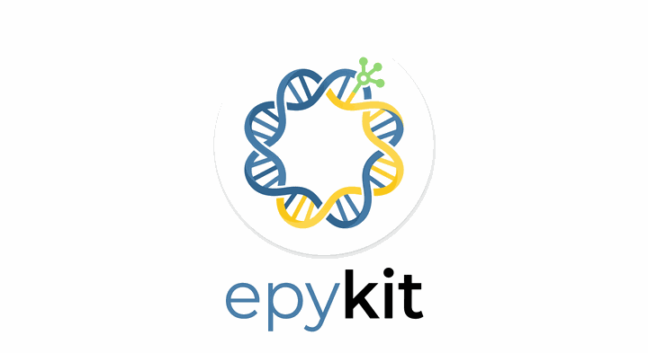

<p align="center">
  
</p>

<p align="center">
  <strong>A Python-native WGBS methylation analysis pipeline.</strong><br>
  Bismark / MethylDackel coverage files → DMC → DMR → annotation → shareable HTML reports,<br>
  over a partitioned-Parquet methylstore with lazy I/O.
</p>

<p align="center">
  
  
  <a href="LICENSE"></a>
  <a href="https://d-ert.github.io/epykit/"></a>
</p>

<p align="center">
  <a href="https://d-ert.github.io/epykit/">Documentation</a> ·
  <a href="CHANGELOG.md">Changelog</a>
</p>

---

**Fast, memory-efficient whole-genome bisulfite sequencing (WGBS) methylation analysis in Python.**

Analyze Bismark or MethylDackel coverage files with speed and a light memory footprint. epykit processes partitioned Parquet data chromosome by chromosome, so large WGBS studies stay manageable. Get differential methylation results, genomic annotations, plots, and shareable reports in one Python workflow.

[Documentation](https://d-ert.github.io/epykit/) · [Changelog](CHANGELOG.md) · [License](LICENSE)

## What you can do

- Import and quality-check WGBS samples.
- Filter and normalize coverage, then find differentially methylated CpGs (DMCs) and regions (DMRs).
- Add gene and CpG-island context to results.
- Explore results with plots or create a shareable interactive HTML report.
- Use the Python API or the `epykit` command-line tool.


## Install

Requires Python 3.10 or newer. With [uv](https://docs.astral.sh/uv/), install the core package:

```bash
uv pip install -e .
```

To include all optional features, such as interactive reports and additional export formats:

```bash
uv pip install -e ".[all]"
```

Or use pip instead of uv:

```bash
pip install -e .
```

For a source checkout, clone the repository first. See the [installation guide](https://d-ert.github.io/epykit/) for optional features and platform notes.

## Quick start

Create a CSV samplesheet with one row per sample:

```csv
sample_id,group,path
ctrl_1,control,data/ctrl_1.bismark.cov.gz
ctrl_2,control,data/ctrl_2.bismark.cov.gz
case_1,case,data/case_1.bismark.cov.gz
case_2,case,data/case_2.bismark.cov.gz
```

Then run a basic analysis in Python:

```python
import epykit as ep

md = ep.read_bismark(
    "samplesheet.csv",
    treatment_group="case",
    control_group="control",
    assembly="hg38",
    store_dir="methyl_store",
)

ep.pp.filter_coverage(md, lo_count=10)
ep.tl.qc(md)
ep.tl.dmc(md)
ep.tl.dmr(md)

md.save("methyl_store/results/analysis")
md.report("methylation_report.html")
```

The analyses write tab-separated result files into `methyl_store/results/` by default. Add annotation with `ep.tl.annotate(...)`, or make plots with functions such as `ep.pl.volcano(md)` and `ep.pl.pca(md)`.

## Command line

The `epykit` command provides the same core workflow for scripts and shell use:

```bash
epykit --help
epykit convert --help
```

Available commands include conversion, filtering, DMC/DMR analysis, annotation, QC, reporting, and export. Run `epykit <command> --help` for options.

## Learn more

- [Full documentation and guides](https://d-ert.github.io/epykit/)
- [Changelog](CHANGELOG.md)
- [Regional GLS benchmark](docs/regional-gls-benchmark-2026-10-10.md)

## License

[AGPL-3.0-or-later](LICENSE).
